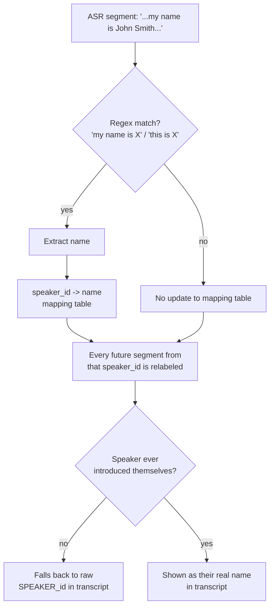

# Speaker Attribution

Diarization only produces anonymous speaker IDs (`SPEAKER_00`, `SPEAKER_01`, ...). Names are recovered opportunistically from self-introductions in the transcript.

**Limitation:** if a speaker never says a self-introducing phrase, they stay labeled by their raw diarization ID for the whole transcript.
